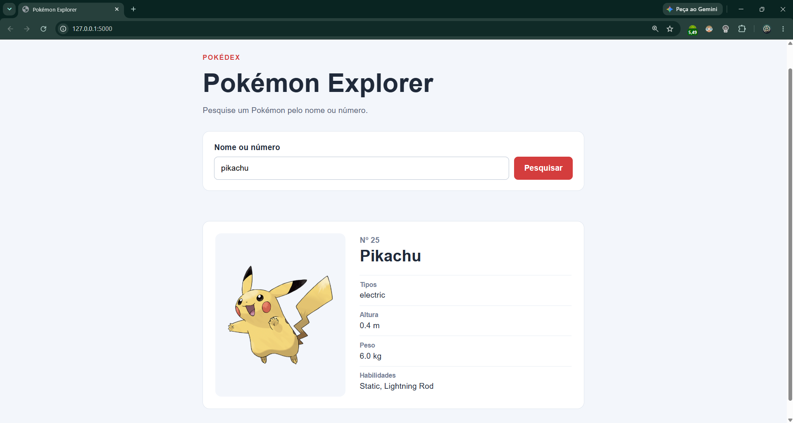

# Pokémon Explorer

Uma aplicação web simples para pesquisar Pokémon pelo nome ou número da Pokédex. O projeto demonstra uma integração entre uma interface em HTML, CSS e JavaScript, um backend Flask e a [PokéAPI](https://pokeapi.co/).

## Preview



## Funcionalidades

- Pesquisa de Pokémon por nome ou número da Pokédex.
- Exibição de nome, número, imagem, tipos, altura, peso e habilidades.
- Indicador visual enquanto a pesquisa está em andamento.
- Mensagem orientativa quando o Pokémon não é encontrado.
- Tratamento de timeout, falha de conexão e resposta inválida da API externa.

## Tecnologias utilizadas

- **Python:** linguagem usada na lógica do servidor.
- **Flask:** serve a página e disponibiliza o endpoint de pesquisa.
- **Requests:** realiza, no backend, as chamadas HTTP à PokéAPI.
- **HTML:** define a estrutura da interface.
- **CSS:** estiliza a página e adapta o layout a diferentes tamanhos de tela.
- **JavaScript:** envia a pesquisa ao Flask e atualiza os dados e mensagens na página.
- **PokéAPI:** fornece os dados dos Pokémon.

## Arquitetura e funcionamento

1. A pessoa informa um nome ou número no formulário.
2. O JavaScript envia uma requisição ao endpoint do Flask.
3. O Flask valida a entrada.
4. O backend usa Requests para consultar a PokéAPI.
5. O Flask seleciona os campos necessários e os devolve em JSON.
6. O JavaScript atualiza a ficha do Pokémon ou apresenta uma mensagem de erro.

O navegador se comunica somente com o backend local. Ele não consulta a PokéAPI diretamente.

## Pré-requisitos

- Git.
- Python 3.
- Acesso à internet para consultar a PokéAPI.

## Instalação e execução local

### Clonar o repositório

```bash
git clone https://github.com/pachecosamuel/pokemon-explorer.git
cd pokemon-explorer
```

### Criar e ativar o ambiente virtual

Execute os comandos correspondentes ao seu terminal, a partir da pasta do projeto. No Windows, os exemplos usam o inicializador `py`; se ele não estiver disponível, use `python` no lugar. No macOS/Linux, use `python3`.

#### PowerShell

```powershell
py -m venv .venv
.\.venv\Scripts\Activate.ps1
```

#### CMD (Prompt de Comando)

```cmd
py -m venv .venv
.venv\Scripts\activate.bat
```

#### Git Bash

```bash
py -m venv .venv
source .venv/Scripts/activate
```

#### macOS/Linux

```bash
python3 -m venv .venv
source .venv/bin/activate
```

### Instalar dependências e iniciar a aplicação

Com o ambiente virtual ativo, instale as dependências e execute o servidor:

```bash
python -m pip install -r requirements.txt
python app.py
```

Abra <http://127.0.0.1:5000> no navegador. Para encerrar o servidor, use `Ctrl+C` no terminal.

## Exemplos de utilização

Digite qualquer um destes valores no campo de pesquisa:

- `pikachu` — pesquisa pelo nome.
- `25` — pesquisa pelo número da Pokédex.
- `charmander` — pesquisa pelo nome.

## Endpoint

### `GET /api/pokemon/<identifier>`

Consulta um Pokémon pelo nome ou número e retorna JSON com os campos usados pela interface: `name`, `number`, `image`, `types`, `height`, `weight` e `abilities`. Erros são retornados em JSON com uma mensagem descritiva e o status HTTP correspondente.

## Tratamento de erros

- **Pokémon não encontrado:** retorna uma mensagem para conferir o nome ou número informado.
- **Timeout da API externa:** retorna uma mensagem para tentar novamente; a chamada usa um timeout de 5 segundos.
- **Falha de conexão:** informa que não foi possível conectar à PokéAPI.
- **Resposta externa inválida:** informa que a resposta recebida não pôde ser processada.

## Créditos

Os dados são fornecidos pela [PokéAPI](https://pokeapi.co/).
